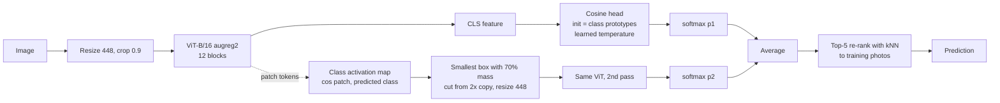
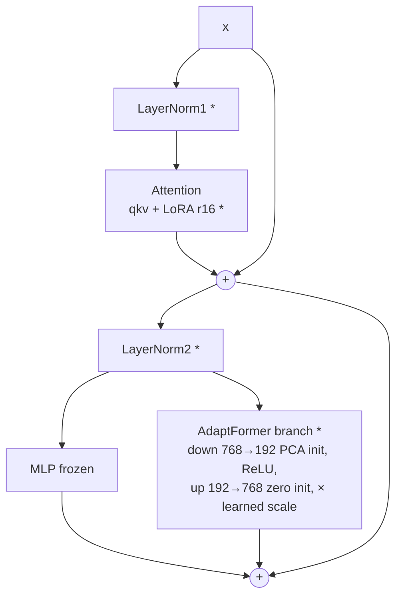

# CS604 Final Report — First Draft (team 08)

Draft by Van, 2026-10-28, for the team to review. This is the storyline and the
numbers, not the final CVPR LaTeX. Every number comes from a run record:
`report/progress_log.md` and `report/experiment_index.csv` on group `main`
(teammates' runs), Van's `report/EXPERIMENTS.md` (laptop screens, personal repo),
and the run folders in `CS604_RUNS`. **[TODO]** marks something a teammate needs to
confirm or fill in.

Two kinds of accuracy appear below. Keep them apart in the report:

- **CodaBench**: public val top-1 (50,000 images, 5 per class). This is the headline metric.
- **Holdout**: our own labelled holdout, 5 training images per class held out (50,000
  images, never trained on). Used to compare settings without spending CodaBench
  submissions. Van's holdout uses all 10,000 classes (split seed 604). Anastasia's and
  Qian's "pilot" holdouts use a 1,000-class subset, so their absolute numbers (~0.88–0.91)
  are higher and only comparable within one pilot. Seed noise is about 0.3 points, so
  differences under ~0.4 are ties.

---

## 0. Headline results

| | Task 1: full fine-tune | Task 2: parameter-efficient |
| --- | --- | --- |
| Method | ViT-B/16 full FT at 448 px, prototype cosine head, layer-wise lr decay | AdaptFormer (width 192) + LoRA r16 on qkv + trainable biases/LayerNorms, at 448 px |
| CodaBench, single view | **0.825** | **0.812** |
| CodaBench, crop 0.9 + zoom (2 passes) | **0.832** | **0.822** |
| CodaBench, + kNN re-ranking | **0.8407** (Anastasia, 2026-10-27) | **0.8308** (2026-10-28) |
| Trainable params (backbone, course %) | 100% (93,930,241 incl. head) | **4,262,412 = 4.94%** of the 86.25M backbone at 448 |
| Trainable params incl. 10,000-class head | 93.93M | 11.94M (12.18% of 98.07M) |
| Inference latency, batch 1 / batch 64, one pass (A100, bf16) | 8.47 / 1.17 ms per image | 13.45 / 1.56 ms per image (11.27 / 1.33 with LoRA merged) |
| Inference latency, batch 1 / batch 64, with zoom (submitted path) | 23.43 / 2.54 ms per image | 33.78 / 3.32 ms per image (29.88 / 2.86 with LoRA merged) |
| Training | A100 40 GB, 144.0 min, 2.40 h, 96 GB-h | A100 40 GB, 144.0 min, 2.40 h, 96 GB-h |
| Peak VRAM | 17.80 GB | 14.66 GB |
| Epochs in budget | 5.5 | 5.5 |
| Run folder | `CS604_RUNS/full_ft_20261017_122237` | `CS604_RUNS/van_adaptformer_20261021_083823` |

The 0.8407 row is crop 0.9, a second zoom pass, then a top-5 re-rank. Both latency rows
are A100 timings of these two 448 checkpoints from one session (Section 5.3); the zoom row
is the submitted two-pass path. Re-ranking adds under 0.1 ms per image on top.

References from the course PDF (a PhD student's numbers): zero-shot with an initialised
head 43.7%, full FT 70.8%, LoRA 68.3% at 0.34%. Our first submissions were 0.610 (full FT)
and 0.668 (last-block attention).

Not used for any submitted number (team decision 2026-10-27): class-count balancing. It
raised Task 1 to 0.845, but only by using the fact that val has exactly 5 and test exactly
10 images per class, which a deployed model would not know. We report it as an analysis.

---

## 1. Problem and constraints

- **Data.** 10,000 classes, 45 training images per class (450,000), val 5 per class,
  test 10 per class. Neighbouring class IDs are visually close under the pretrained
  features (Section 2.4). The genus reading assumes iNaturalist’s ID order; class names
  are not in the release, so that part is a hypothesis. The practical fact is
  **fine-grained identification**: many classes are look-alike siblings.
- **Budget.** 2 h × 48 GB = 96 GB-hours per training run. We ran every final on a Colab
  A100 40 GB for 2.4 h (= 96 GB-h). The cosine schedule is fitted to the clock, so the
  learning rate reaches zero exactly at the time limit.
- **Backbone.** `vit_base_patch16_224.augreg2_in21k_ft_in1k` (team decision 2026-10-05).
- **Rules confirmed with the Prof (2026-10-03).** The classifier head is always trained and
  is not counted in the 5% limit; the 5% applies to the backbone.
- **Integrity.** No val/test labels used.

---

## 2. The story: problems we found and what we did about them

This is the spine for both the report and the presentation. Each step is: what we
believed, what the evidence said, what we changed.

### 2.1 Starting point: "the budget is the enemy, so buy more epochs"

**Belief.** With 2.4 GPU-hours and 450,000 images, the run is short. Our first plans
saved compute to fit in more epochs: stay at the native 224 px, or train mostly at low
resolution and switch to high resolution only at the end (progressive resizing / FixRes).

**First results (CodaBench, all 224 px):**

| Run | Who | Setting | CodaBench |
| --- | --- | --- | --- |
| Frozen backbone + linear probe | Anastasia | head only | 0.625 |
| Full FT, constant lr, batch 32 | Qian | backbone lr 1e-5, head 1e-3 | 0.610 / 0.613 |
| + class-mean head init | Qian | | 0.621 |
| + cosine decay (shared trainer) | Qian | | 0.663 |
| Last-block attention (2.75%) | Qian | | 0.668 |

A full fine-tune barely beat a frozen probe. Something other than epoch count was wrong.

### 2.2 Problem 1: the optimisation recipe, not the number of epochs

Van tuned the full fine-tune on a laptop against the holdout (one change at a time;
Section 4.1). What mattered:

1. **A schedule that decays to zero** (warmup + cosine fitted to the time limit): one epoch
   with it beat 11 epochs at a constant rate.
2. **Layer-wise lr decay 0.75** with a 40× higher top rate (4e-4): removing it cost
   **6.7 points** (the early pretrained layers get damaged).
3. **Prototype head start** instead of LP-FT (a trained linear probe): **+1.6 to +2.0**,
   although the probe starts 16 points higher. Anastasia reproduced this independently at
   336 (LP-FT −2.2) and for LoRA (−2.9).
4. **Head lr 10× the backbone**: +1.5 from a probe start; from prototypes 10× and 30× tie.

CodaBench: **0.663 → 0.757** with the same 224 px and budget.

**Evidence that epochs are not the bottleneck:**

- Length curve at 224 (holdout): 3 → 6 epochs +0.98; 6 → 12 epochs only +0.53.
- Frozen-head LoRA with 10× the budget: +1.1 (51.8% → 52.9%). Its diagnosis: it couldn't
  even fit its own training images (61.6%), which pointed at the frozen head, not time.
- Anastasia's LoRA pilot: doubling epochs at equal time bought nothing (L: 0.8866 at 3
  epochs vs 0.8898 at 6).

### 2.3 Problem 2: fine-grained detail. We went the opposite way on resolution

**What we noticed in the data.** 79% of the images have a short side of 300–400 px, so
224 throws away detail that is in the file. The errors are look-alike relatives
(Section 2.4): the deciding cue is often small (wing pattern, leaf edge).

**Saving compute with low resolution lost every time:**

| Test | Who | Result |
| --- | --- | --- |
| Progressive 224 → 384, equal compute (full FT, 10 img/class) | Van | **−4.3** vs plain 384, despite 2.5× the epochs |
| LoRA 224 → 336, equal epochs / equal time (pilot) | Anastasia | −1.20 / −0.88 |
| Full FT 224 then 336 (2,000-class subset) | Anastasia | 336 beat it **[TODO Ana: exact numbers for the report]** |

**Going up in resolution won at equal compute, even though each epoch costs more:**

| Training size | Full FT holdout (equal 0.48 × 48 GB-h, crop 0.9) | Epochs that fit | AdaptFormer holdout (equal compute) |
| --- | --- | --- | --- |
| 336 | 63.20 | 7.7 | 59.63 |
| 384 | 64.06 (+0.86) | 5.5 | 61.18 (+1.55) |
| 448 | 64.79 (+0.73) | 4.1 | **62.72 (+1.54)** |
| 512 | 64.98 (+0.19, flat) | 2.9 | not run |

(10 training images per class, so absolute numbers are low; the full runs use 45.)

On CodaBench, full FT: **224 0.757 → 336 0.807 (Anastasia) → 384 0.817 → 448 0.825**.
The screen predicted each step (+0.86 → +1.0 actual; +0.73 → +0.8 actual). We stopped at
448 because 512 was flat on the screen and costs 30% more per epoch.

A key observation: **resolution helps only when the backbone adapts.** Frozen features
get worse at higher resolution (prototype accuracy 43.9% at 224, 42.5% at 336, 37.2% at
448; Anastasia's frozen probe 0.625 at 224 vs 0.620 at 336), yet fine-tuned models gain
+5 points from 224 to 336. PEFT benefits too: AdaptFormer's gain per resolution step is
larger than full FT's and had not flattened at 448.

### 2.4 Problem 3: look-alike siblings. Loss design didn't fix it; looking closer did

**Diagnosis (no training).**

- Class IDs track visual similarity: prototype cosine 0.80 for IDs 1 apart vs 0.28 for
  random pairs; for half the classes the most similar class is within 5 IDs (Anastasia).
  Calling those neighbours a genus is the iNaturalist reading, not something we could
  check against class names.
- Errors are siblings, and the 1,000-class pilots understate it. On a random 1,000-class
  pilot, 18% of LoRA errors fall within 5 IDs and the true class is 2nd in 48% of errors.
  On the full 10,000-class holdout those figures are **34%** and **37%** (Anastasia). Van’s
  full-FT holdout puts 46% of errors within ±10 IDs.
- The other big cause, measured on the 1,000-class pilot: photos showing a part, life
  stage or season that the training photos barely cover (59% of errors flagged
  "unseen look").

**Changing the loss to separate siblings did not help:**

| Idea | Who | Result |
| --- | --- | --- |
| Neighbour label smoothing (mass onto ±5 IDs), full FT | Van | −0.14 (tie) |
| Taxonomy-aware smoothing, 3 variants (LoRA, sibling-block pilot) | Anastasia | ties; 0.2 smoothing −0.86 |
| Extra CosFace margin against siblings | Anastasia | −1.3 to −7.3 (errors scatter to unrelated classes) |
| Uniform CosFace margin 0.1 | Van / Anastasia | AdaptFormer +0.60 (1 epoch, kept); LoRA +0.18 (tie) |

Conclusion: reshaping the objective doesn't give the features the missing information. The
remedies that worked add information: more pixels (resolution) and a closer look at
prediction time.

**Prediction-time views (no retraining), in order of discovery:**

1. **Tighter test crop.** Training uses RandomResizedCrop (objects look larger than in a
   0.9 centre crop at test time; the FixRes effect). Crop 0.7 + flip: +1.5 holdout,
   **+1.6 CodaBench** at 224 (0.757 → 0.773). The gain shrinks with resolution (+0.6 at
   336; crop 0.9 is best at 448).
2. **"Look, then zoom in" (Van).** Classify, take a class-activation map (cosine of each
   patch token with the predicted class's head weight), cut the smallest window holding 70%
   of it from a 2× copy, classify again, average. Beats flip at the same two passes
   (+0.85 / +0.62 holdout). The saliency location matters: a centred box of the same size is
   +0.28 worse for AdaptFormer. CodaBench +0.5 to +1.3 depending on the model.
3. **kNN re-ranking (Anastasia).** The head stays. Only its top 5 classes are re-scored,
   `log p + 20 × mean of the 3 best cosines to that class's training photos`. K = 5, m = 3
   and beta = 20 were fixed on the 10,000-class holdout before any CodaBench file
   (+1.29; both halves chose the same values). CodaBench, same pass: LoRA plain
   **0.7842 → 0.7982** (+1.40); Task 1 crop 0.9 + zoom **0.8322 → 0.8407** (+0.85);
   Task 2 crop 0.9 + zoom **0.822 → 0.8308** (+0.88, 2,580 of 50,000 predictions
   changed). Same K, m and beta on all three; not retuned. No training. The bank is
   the 450,000 training features (~0.7 GB fp16), built once (~15 min at 336, ~25–30 min
   at 448), outside the 144-minute training clock. Re-ranking is 0.03 ms per image on
   the 336 LoRA run and 0.062 ms per image at batch 64 on the Task 2 run.
4. **Class-count balancing (Van; excluded).** Sinkhorn rebalancing to the known 5 per class:
   +1.7 on CodaBench (0.828 → 0.845). Excluded by team decision (Section 6).

### 2.5 Task 2: which ~4% of the parameters to train?

The PDF asks for <5% of the backbone. The team covered the method list between us, all with
the same budget and, from 2026-10-07, the same recipe pieces from Task 1 (prototype cosine
head with a 10× head lr, warmup + cosine to the clock, label smoothing 0.1).

**Method survey (CodaBench, full data, 2.4 h A100 each):**

| Method | Who | Backbone % | Res | Plain | Best view |
| --- | --- | --- | --- | --- | --- |
| Frozen + linear probe | Anastasia | 0 | 224 | 0.625 | |
| Last-block attention (selected layer) | Qian / Wenqi | 2.75 | 224 / 336 / 448 | 0.668 / 0.679 | 0.685 (448, crop+flip) |
| Prefix tuning, length 50 | Qian | 1.07 | 336 | 0.721 | |
| BitFit (all biases) | Qian | 0.12 | 336 / 448 | 0.734 | 0.762 (448 cosine head, crop+flip) |
| Serial adapter w96 + extras | Anastasia | 4.68 | 336 | 0.776 | 0.785 |
| GPS (gradient-selected weights) | Anastasia | 4.63 | 336 | 0.779 | |
| AdaptFormer w192 | Van | 4.13 | 336 | 0.779 | 0.797 (zoom) |
| DoRA r24 + extras | Anastasia | 4.75 | 336 | 0.783 | 0.793 |
| LoRA r24 (no extras) | Anastasia | 4.12 | 336 | 0.784 | 0.798 (kNN) |
| LoRA r24 + extras | Anastasia | 4.65 | 336 | 0.785 | 0.799 (zoom) |
| LoRA r24 + VPT-Deep | Qian | 4.74 | 336 | | 0.793 (crop+flip) |
| LoRA r24 + 25% whole-image crops | Qian | 4.94 | 448 | | 0.810 (zoom) |
| AdaptFormer + biases/norms | Van | 4.27 | 336 / 384 / 448 | 0.804 (448) | 0.814 (448, zoom) |
| **AdaptFormer + biases/norms + LoRA r16** | Van | **4.94** | 448 | **0.812** | **0.8308** (zoom + kNN) |

Pilot-only (1,000 classes, not submitted): AdaLoRA −2.7 vs LoRA (Qian).

The "Best view" column is not a ranking. It mixes plain crop, flip, zoom and kNN.
On plain crop at 336, AdaptFormer, GPS, DoRA and LoRA sit in **0.779–0.785**. The
controlled comparison is at 448: last-block **0.685**, BitFit **0.762**, LoRA
**0.810** (zoom), AdaptFormer + LoRA **0.822** (zoom). Early rows also used weaker
recipes, so part of the gap below is the head and the schedule, not only which
weights were trained.

**What the survey taught us:**

- **Spread the budget across all layers.** Methods touching every block (LoRA, adapters,
  AdaptFormer, GPS) beat concentrated ones (last block, a few full matrices). At 448
  that gap is about 6–14 points.
  Anastasia's controls: one full-rank attention block costs ~1 point at any depth; r16 in all
  12 blocks beats r24 in 8 blocks at equal parameters (+0.76).
- **The head setup matters more than the adapter type.** In Anastasia's LoRA ablation the
  head start × head lr swings 6 points; rank 16 → 24 is +0.66; DoRA +0.12; extras +0.14.
- **Capacity is not the limit.** AdaptFormer fits its training images almost as well as full
  FT (95.0% vs 95.5% top-1 on seen images) but generalises 1.4 points worse. More adapter
  width beyond 192 or a depth-graded layout gave nothing; regularisation (RandAugment,
  adapter dropout) tied.

### 2.6 Our Task 2 design: AdaptFormer, tuned step by step

Why AdaptFormer: it adds a parallel bottleneck beside each MLP and starts as the identity
(up-projection at zero), so the model starts exactly at the pretrained prototype score. It
trained ~1.3× faster than full FT on the laptop. Van owned it and wrote it from scratch.

Holdout ablations (336 px, all 10,000 classes, 40/5 split; one change at a time):

| Step | Change | Holdout | Gain | Backbone % |
| --- | --- | --- | --- | --- |
| lr screen, 1 epoch | lr 3e-4 / **1e-3** / 3e-3 / 1e-2 | 70.56 / **71.49** / 71.49 / 70.45 | | 4.13 |
| init/design, 1 epoch | PCA init of `down` | 71.56 | +0.08 | |
| | adapter reads norm2(x), not the residual | 71.72 | +0.24 | |
| | learned per-block scale | 71.63 | +0.15 | |
| loss, 1 epoch | CosFace margin 0.1 | **72.09** | **+0.60** | |
| | margin 0.2 | 70.94 | −0.54 | |
| | no label smoothing | 71.16 | −0.32 | |
| | width 64 instead of 192 | 70.92 | −0.56 | 1.38 |
| 3 epochs | all four positive changes combined vs control | **76.26** vs 75.27 | **+0.99** | 4.13 |
| 3 epochs | + trainable biases and LayerNorm weights | **76.76** | +0.50 | 4.27 |
| 1 epoch | SSF instead of biases/norms | | +0.21 (tie), 21% slower | 4.37 |
| 3 epochs | **+ LoRA r16 on qkv** | **77.33** | **+0.57** | 4.96 (4.94 at 448) |
| 3 epochs | RandAugment + erasing / adapter dropout 0.1 | 76.44 / 76.72 | ties | |
| 1 epoch | depth-graded widths 96/192/288 | | −0.07 (tie) | 4.27 |
| equal compute | resolution 336 / 384 / 448 | 59.63 / 61.18 / 62.72 | +1.55, +1.54 | |

Each kept change was confirmed on CodaBench:

| Final run | CodaBench plain | Best view |
| --- | --- | --- |
| AdaptFormer recipe, 336 | 0.779 | 0.797 (zoom) |
| + biases/norms, 336 | | 0.802 (zoom) |
| same at 384 | 0.794 | 0.807 (zoom) |
| same at 448 | 0.804 | 0.814 (crop 0.9 + zoom) |
| **+ LoRA r16, 448** | **0.812** | **0.822** (crop 0.9 + zoom) |

---

## 3. Design (framework figure)

**[TODO: draw this properly for the report; this is the content.]**

Inside each block for Task 2 (backbone frozen except where marked):

`*` = trainable. All Linear/LayerNorm biases also train. Task 2 loss: cross-entropy with
label smoothing 0.1 and a CosFace margin 0.1 on the cosine head. The kNN box above is
Task 1 only; Task 2 stops at the averaged softmax.

Task 1 uses the same views with every weight trainable and no CosFace margin: layer-wise
lr decay 0.75 (top block 4e-4), head lr 4e-3, wd 0.05 (none on norms/biases), drop_path
0.1, clip 1.0, label smoothing 0.1, batch 256, bf16, 5% warmup then cosine ending at the
144-minute limit.

---

## 4. Ablation tables

### 4.1 Task 1 (full fine-tune), holdout, all 10,000 classes

| Group | Setting | Holdout | vs reference |
| --- | --- | --- | --- |
| Starting points (no FT) | prototype head / linear probe | 43.90 / 60.37 | |
| Backbone lr, 1 epoch (LP-FT start) | 5e-5 / 1e-4 / 2e-4 / **4e-4** / 8e-4 | 66.24 / 66.82 / 67.22 / **67.47** / 67.34 | |
| 3 epochs | control (head lr = backbone) | 69.83 | |
| | head lr 10× | 71.37 | +1.53 |
| | no layer decay | 63.12 | **−6.7** (vs control) |
| | crop scale [0.35, 1] / no colour jitter | 71.11 / 71.29 | ties |
| Head init, 3 epochs | linear probe (seed 0 / 1) | 71.37 / 71.03 | seed noise 0.33 |
| | **prototypes** | **72.98** | **+1.6 to +2.0** |
| Length at 224 | 3 / 6 / 12 epochs | 72.98 / 73.97 / 74.49 | diminishing |
| Resolution, 3 epochs | 224 / 336 | 72.98 / **78.39** | **+5.4** |
| Resolution, equal compute | 336 / 384 / 448 / 512 | 63.20 / 64.06 / 64.79 / 64.98 | flat at 512 |
| | progressive 224 → 384 | 59.74 | −4.3 |
| Loss | neighbour label smoothing | 63.92 vs 64.06 | tie |
| Eval crop (224, 6 ep) | 0.9 / 0.75 / 0.7 + flip | 73.97 / 75.34 / 75.50 | +1.5 |
| Eval view (336, 3 ep) | plain / + flip / + zoom | 78.80 / 78.97 / **79.59** | zoom +0.79 |

Teammates' Task 1 checks: backbone-lr pilot without layer decay (Anastasia: 1e-4 already
−2.6 vs 1e-5); head-init pilot at 336 (LP-FT −2.2 vs prototype).

### 4.2 Task 2

See Section 2.6 (AdaptFormer chain) and Section 2.5 (method survey). Teammates' pilot
ablations worth a table in the report: LoRA r24 recipe (head × head lr, rank, extras, DoRA;
Anastasia), parameter selection (LoRA vs GPS vs surgical vs angle-based; Anastasia), BitFit
scope and head type (Qian), prefix placement/length (Qian), VPT on LoRA (Qian), LoRA vs DoRA
vs AdaLoRA at 448 (Qian), selected attention layers (Qian).

### 4.3 Prediction-time (both tasks)

| Model | Plain | Crop + flip | Zoom | Zoom + kNN | (+ balancing, not used) |
| --- | --- | --- | --- | --- | --- |
| Full FT 448 (Task 1) | 0.825 | 0.827 | 0.832 | **0.8407** | 0.845 (crop 0.75 + zoom) |
| AF + LoRA 448 (Task 2) | 0.812 | | **0.822** | **0.8308** | |
| LoRA r24 336 (Anastasia) | 0.785 | 0.793 | 0.799 | | |
| LoRA r24 no extras 336 | 0.784 | | | 0.798 (no zoom) | |

---

## 5. Results for the marking criteria

### 5.1 Top-1 accuracy: CodaBench over time

Task 1: 0.610 → 0.621 → 0.663 → **0.757** (LLRD recipe) → 0.773 (crop + flip) → **0.807**
(336) → 0.819 (zoom) → 0.824 (384) → 0.828 (448) → **0.832** (crop 0.9 + zoom) →
**0.8407** (+ kNN).

Task 2: 0.668 (last block) → 0.717 (LoRA r16, 336) → 0.734 (BitFit) → 0.779 / 0.785
(AdaptFormer / LoRA r24) → 0.802 (AF + biases/norms, zoom) → 0.814 (448) → **0.822**
(+ LoRA r16, zoom) → **0.8308** (+ kNN).

**[Figure idea]** one line chart, two series, x = submission order, annotated with the
change that caused each jump. This is the presentation's main slide.

### 5.2 Trainable parameters

Backbone at 448 px = 86,250,240 (ViT-B with a 785-token position embedding); head =
7,680,001 (cosine head, 10,000 × 768 + temperature).

| Task 2 component | Parameters |
| --- | --- |
| AdaptFormer down + up, width 192, 12 blocks (+ 12 scales) | 3,550,476 |
| Biases + LayerNorm weights | 122,112 |
| LoRA r16 on qkv, 12 blocks | 589,824 |
| **Backbone total** | **4,262,412 = 4.94%** |

The course percentage is that 4.94%: new backbone parameters divided by the original
backbone, head excluded (Prof, 2026-10-03). The 11.94M figure adds the 10,000-class
head. The 98.07M denominator also adds the new adapter weights, so 12.18% is not the
course number.

**[TODO]** check the component split against the run's printed `[params]` line (the
total 11,942,413 trainable incl. head is from `run_stats.txt`).

### 5.3 Inference latency

**Every latency in this report is measured on a Colab NVIDIA A100-SXM4-40GB** (the GPU the
finals trained on), with the same protocol: synthetic inputs already on the GPU, bf16,
30 warm-ups + 200 timed iterations, excluding image loading, preprocessing and transfers.
Laptop (RTX 5080) timings from the screening work are not used.

**The two finals, timed in one session (2026-10-28)** with `scripts/van_latency_zoom.py`
(`notebooks/van_latency_colab.ipynb`); results in `inference_latency_zoom.json` in each run
folder. "Zoom" is the exact submission path of `src.predict --zoom` (plain pass, CAM box,
crop from the 2× copy, second pass, softmax average).

| Final model (448 px) | One pass, batch 1 | One pass, batch 64 (per image) | Zoom, batch 1 | Zoom, batch 64 (per image) |
| --- | --- | --- | --- | --- |
| Task 1 full FT | 8.47 ms | 1.17 ms | 23.43 ms | 2.54 ms |
| Task 2 AF + LoRA, as trained | 13.45 ms | 1.56 ms | 33.78 ms | 3.32 ms |
| Task 2 AF + LoRA, LoRA merged | 11.27 ms | 1.33 ms | 29.88 ms | 2.86 ms |

Merging the LoRA into the qkv weights (W + B·A·alpha/rank) is exact: all 12 layers merged,
fp32 top-1 agreement 100% on 128 images, max logit difference 8e-6. So the merged row is the
same model with the same predictions. The AdaptFormer branch is a separate non-linear
bottleneck and cannot be merged; it is the remaining cost over full FT (+33% at batch 1,
+14% at batch 64, merged).

Session-to-session variation: an earlier session timed the same two finals' single pass at
7.16 / 1.17 ms (Task 1) and 12.38 / 1.56 ms (Task 2) (`inference_latency.json`). Batch 64
is stable; batch 1 moves by about 1 ms between sessions, so compare models only within one
session, as in the table above.

Other models, single pass, from earlier sessions on the same A100 setup:

| Model (one forward pass) | Batch 1 | Batch 64 (per image) | Source file |
| --- | --- | --- | --- |
| LoRA r24 336, merged (= plain ViT-B) | 7.78 ms | 0.65 ms | `lora_20261007_051926/inference_latency_merged.json` |
| LoRA r24 336, unmerged | 14.2–15.4 ms | 1.07 ms | same, and Anastasia's CSV rows |

Teammates' zoom timings (the `inference_latency_zoom.json` files in `CS604_RUNS`):

| Model with zoom | Batch 1 | Larger batch (per image) | Single pass, batch 1 |
| --- | --- | --- | --- |
| Full FT 336 (Anastasia's 0.819 checkpoint; Wenqi) | 20.65 ms | 1.42 ms (batch 64) | 7.94 ms |
| LoRA r24 336, unmerged (Wenqi) | 36.79 ms | 2.29 ms (batch 64) | 14.4–15.0 ms |
| LoRA r24 448, unmerged (Qian) | 41.96 ms | 4.27 ms (batch 32) | not measured |

So at batch 1 zoom costs 2.5–2.8× a single pass, not 2×: the box search and the resize of
the 2× copy add fixed overhead. At batch 64 it is about 2.2×.

kNN re-ranking adds **0.0295 ms per image** at batch 128 on the 336 LoRA checkpoint
(`rerank_stats.json`), plus a 0.7 GB fp16 feature bank. On the 448 full fine-tune the
same step is under 0.1 ms per image. The bank is built once (~15 min at 336, ~25–30 min
at 448) and is not part of the 144-minute training clock.

### 5.4 Training GPU-hours and implementation details

- Every final: one A100-SXM4-40GB, 144.0 training minutes, stopped by the clock
  (`time_limit_reached=True`), 2.40 h × 40 GB = 96 GB-h. The cosine schedule is fitted to the
  time limit (`schedule_fit_time`).
- Outside the 144-minute training clock, and stated separately: building class prototypes
  (one frozen-backbone pass), PCA calibration for AdaptFormer (8 batches, ~10 s), and the
  kNN feature bank (one forward pass over the training set: ~15 min at 336, ~25–30 min at
  448). The bank stores features; it does not train parameters. **[TODO]** confirm with
  the Prof that this pass is reported beside the budget rather than inside it. The 0.8407
  file depends on the bank.
- Tuning compute (not part of the budget): Task 1 laptop tuning ~17.5 h on an RTX 5080
  Laptop (16 GB); Task 2 AdaptFormer screens ~40 min to 2 h each on the same laptop;
  teammates' pilots 4–12 min each on an A100. **[TODO: total per person.]**
- Software: PyTorch 2.11 + timm, bf16 autocast, AdamW.

### 5.5 Loss curves

Saved per run in `CS604_RUNS/<run>/figures/<run>_loss.png` and `_epoch_loss.png`; raw
numbers in `step_log.csv` / `epoch_log.csv`. Epoch-mean training loss of the finals:

| Epoch | 1 | 2 | 3 | 4 | 5 | 6 (partial) |
| --- | --- | --- | --- | --- | --- | --- |
| Task 1 full FT 448 | 3.76 | 2.95 | 2.57 | 2.24 | 2.02 | 1.95 |
| Task 2 AF + LoRA 448 | 5.67 | 5.20 | 5.05 | 4.83 | 4.55 | 4.35 |

Task 2's loss is higher because it includes the CosFace margin times the learned
temperature (the temperature grows from 20 to ~68 during training), so the two curves are
not comparable in level. Both curves are still falling at the time limit. The evidence
that more epochs would not have been the better use of the budget is the 224 length
curve (6 → 12 epochs, +0.53) and the equal-compute resolution screen, not these two
plots. The finals train on all 45 images per class, so they have no validation curve.
For train-versus-validation curves, use the holdout screens (`full_proto_336_len3`,
`af_bn_bias_norm_e3`: holdout loss per epoch in `metrics.csv`).

---

## 6. Trade-offs and what we recommend

**Accuracy.** Full FT wins: 0.8407 vs 0.8308 with zoom and kNN (+1.0), 0.832 vs 0.822
with zoom alone, 0.825 vs 0.812 single view.
The gap fell from 2.8 points at 336 in early October (0.807 vs 0.779) to 1.0. PEFT does not
beat full FT here, unlike the PDF's expectation for small data: 45 images × 10,000 classes
is 450,000 images, and the pilots on 1,000 classes (40k images) show the crossover
(LoRA ≥ full FT on the pilot, full FT +2.2 at full scale).

**Parameters and storage.** Task 2 trains 4.94% of the backbone. A new task needs 17 MB of
adapters plus the 31 MB head instead of a 375 MB model.

**Training cost.** Both used the full 96 GB-h and got the same 5.5 epochs at 448. PEFT
saved memory (14.7 vs 17.8 GB peak), not time: gradients still flow through the whole
frozen backbone. A smaller GPU could run Task 2, not Task 1.

**Inference cost.** Measured in one A100 session: Task 2 as trained is +59% at batch 1
(13.45 vs 8.47 ms) and +33% at batch 64 (1.56 vs 1.17 ms). Its LoRA merges exactly into the
weights, which brings that to +33% / +14% (11.27 ms / 1.33 ms) with identical predictions; the
rest is the AdaptFormer branch, which cannot be merged. With zoom, as submitted: 23.4 ms
(Task 1) vs 29.9 ms (Task 2 merged) at batch 1. So:

| If you care most about | Choose |
| --- | --- |
| Best accuracy | Full FT 448 + zoom + kNN (0.8407) |
| Best accuracy under 5% | AdaptFormer + LoRA 448 + zoom + kNN (0.8308) |
| Lowest latency under 5% | LoRA r24 merged (0.785 plain / 0.799 zoom at 336, same speed as plain ViT-B) |
| Fewest parameters | BitFit 0.12% (0.762 at 448) |

**Prediction-time extras.** Zoom costs 2.2–2.8× the single-pass latency for +0.5 to +1.0. kNN re-ranking
keeps the head and only reorders its top 5 classes. On CodaBench that is **+1.40** for
plain LoRA at 336 (0.7842 → 0.7982) and **+0.85** on top of Task 1 zoom
(0.8322 → 0.8407) and **+0.88** on Task 2 zoom (0.822 → 0.8308). It costs a 0.7 GB
bank, built once outside the training clock, and under 0.1 ms per image. Both gains use
training photos only,
not val or test labels. Class-count balancing (+1.7, 0.828 → 0.845) is excluded because
it uses the known test class counts.

**What we'd say mattered most, ranked by CodaBench gain:**

1. Optimisation recipe (layer decay, decay-to-zero schedule, prototype head): +9.4
   (0.663 → 0.757).
2. Resolution 224 → 448: +6.8 (0.757 → 0.825).
3. Prediction views + kNN: +1.6 (0.825 → 0.8407).
4. For PEFT: choosing a method that spreads capacity across all layers, then the
   AdaptFormer design and LoRA: +7 over last-block / BitFit at the same resolution.

**What didn't work** (worth one slide; the Prof asked for the investigation): progressive
low-resolution training, longer training at 224, LP-FT, taxonomy-aware losses and sibling
margins, bigger/aimed training crops, heavier augmentation, SSF, DoRA, AdaLoRA, VPT,
depth-concentrated budgets.

---

## 7. Suggested presentation flow (15 min)

1. Task and constraints (1 slide): 10,000 species, 45 photos each, 96 GB-h.
2. Where we started (1): 0.61 full FT ≈ frozen probe. "We thought we needed more epochs."
3. Problem 1, optimisation (2): layer decay, schedule, prototype head; 0.663 → 0.757.
4. Problem 2, fine-grained detail (2): low-res/progressive loses; resolution curve; 0.757 → 0.825.
5. Problem 3, siblings (2): taxonomy finding, error analysis; loss fixes fail; zoom + kNN help.
6. Task 2 (3): method survey chart; why spread capacity; AdaptFormer design figure and
   ablation chain; 0.779 → 0.822.
7. Trade-offs (2): accuracy / params / latency / memory table; recommendation.
8. What didn't work (1).

---

## 8. Open items before the report

- **[TODO Ana]** Exact numbers for the 2,000-class resolution ablation (224 / 336 / 224→336).
- Task 2 re-rank is scored: **0.8308** on 2026-10-28 (crop 0.9 + zoom + K = 5, m = 3,
  beta = 20). Post it. The public board was still on 0.8236, so the “+0.72” is against
  that post, not against the 0.822 zoom file.
- **[TODO]** Phase 2 allows two test files, 31 Oct – 6 Nov. File 1: the Task 1
  0.8407 pipeline (`full_ft_20261017_122237`, crop 0.9 + zoom + kNN). File 2: the Task 2
  0.8308 pipeline (`van_adaptformer_20261021_083823`, crop 0.9 + zoom + the same kNN).
- **[TODO]** Figures: CodaBench progression chart, resolution curve, framework diagram, loss
  curves, error examples (sibling pairs), zoom example boxes.
- The report needs one consistent holdout description per table (Van's 10,000-class holdout
  vs the 1,000-class pilots).
