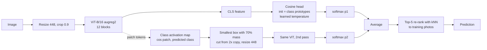
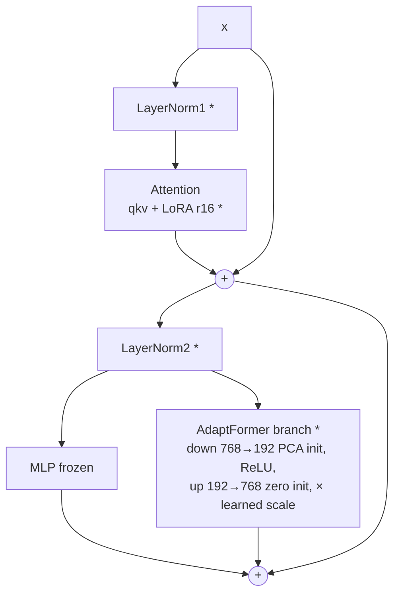

# CS604 Final Report — Outline (team 08)

The outline we will turn into the report, in the CVPR paper structure (LaTeX template:
https://github.com/cvpr-org/author-kit/releases/tag/CVPR2026-v1). This is not the report
itself: it fixes the sections, the argument of each, the numbers and the tables. Short
paragraphs below are starting text, not final wording.
Content and numbers come from Van's draft, `report/final_report_draft.md` (2026-10-28),
and, for kNN re-ranking, `report/progress_log.md` (2026-10-26 to 10-28). The draft and the
log stay the source of truth for numbers; if this file disagrees, fix this file.

Conventions:

- Accuracies are in %. **CodaBench** = public val top-1 (50,000 images, 5 per class), the
  headline metric. **Holdout** = our labelled holdout (5 training images per class held out,
  never trained on). Say which one every table uses.
- **[TODO]** = something a teammate must write, check or fill in. **[PENDING 30 Oct]** =
  waits for the gap experiments (draft Section 8.1).
- Page length is not decided here; tables go wherever the argument needs them for now.

---

## Title

**[TODO]** Working title: *Pixels, Not Epochs: Spending a Fixed Budget on Fine-Grained
Recognition with ViT-B/16*

---

## Abstract

Fine-grained recognition at scale is hard twice over: our task has 10,000 classes, many
differing only in small details from their closest relatives, with only 45 training images
each, and every training run must fit in 96 GB-hours. Short budgets are usually met by
making epochs cheaper so more of them fit. We ask instead what actually limits accuracy
under a fixed budget. Starting from a ViT-B/16 whose full fine-tune barely beat a frozen
linear probe (61.0% vs 62.5%), we find that the limit is not the number of epochs but
(i) an optimisation recipe that preserves the pretrained features and (ii) the amount of
fine detail the model receives. A recipe of layer-wise learning-rate decay, a schedule
fitted to the time limit and a prototype-initialised cosine head gives +9.4 points;
training at 448 px instead of 224 px gives a further +6.8, although it fits fewer epochs.
Because most errors are look-alike neighbouring classes with the true class still near
the top of the ranking, a saliency-guided zoom and a kNN re-ranking of the top 5 classes
against individual training images add +1.6 at prediction time. Our full
fine-tune reaches **84.07%** CodaBench top-1. Under a 5% backbone budget, AdaptFormer with
LoRA and trainable norms and biases reaches **83.08%** with 4.94% of the backbone trained,
compared with 70.8% (full FT) and 68.3% (LoRA) for the reference numbers in the course brief.

---

## 1. Introduction

**Motivation.** Fine-grained recognition at scale is hard twice over: 10,000 classes, many
of which differ only in small details from their closest relatives, with just 45 training
images each. On top of that, we have a fixed budget of 96 GB-hours. The obvious response
to a tight budget is to make each epoch cheaper so more of them fit, for example by
training at low resolution. But it is not clear that training longer is what limits
accuracy on a task like this.

**Question and hypothesis.** We ask: *under a fixed compute budget, what actually limits
fine-grained accuracy, and where should the budget be spent?* We hypothesise that the
limit is **information, not iterations**: the model must (a) keep what the pretrained
backbone already knows and (b) see the small details that separate look-alike classes.
We test this for full fine-tuning (Task 1) and for parameter-efficient adaptation that
trains under 5% of the backbone (Task 2). Task 2 follows from Task 1's finding: if extra
detail only helps a model that can adapt, then the question becomes whether adapting
under 5% of the backbone is enough, and where that 5% should go.

**What we found.** Our first full fine-tune scored 61.0% on CodaBench, below a frozen
linear probe (62.5%). Training longer did not close the gap: at 224 px, doubling from 6 to
12 epochs added only 0.5 points. Instead, three changes, none of which adds epochs,
account for most of our gain (Figure 3):

1. An optimisation recipe that avoids damaging the pretrained features: 66.3% → 75.7%.
2. Training at 448 px instead of 224 px, at equal compute and with fewer epochs:
   75.7% → 82.5%.
3. Looking closer at prediction time (saliency-guided zoom, kNN re-ranking against
   training images): 82.5% → 84.07%.

Error analysis explains why: most errors fall on visually similar neighbouring classes,
and when the model is wrong the true class is usually still near the top of its ranking.
Changing the loss to push those neighbours apart did not help. What helped gave the model
more detail: more pixels in training, a zoomed second look, and re-ranking the top
candidates by how closely the photo matches individual training photos of each.

**Contributions.**

- A budget-fitted full fine-tuning recipe for ViT-B/16 on 10,000 fine-grained classes:
  **84.07%** CodaBench top-1 in 96 GB-hours.
- Evidence that, at a fixed budget, resolution beats epochs for both full fine-tuning and
  PEFT, and that the gain appears only when the backbone adapts.
- A parameter-efficient design (AdaptFormer + LoRA + norms/biases, 4.94% of the backbone)
  reaching **83.08%**, within 1.0 point of full fine-tuning, with a controlled comparison
  of PEFT methods under one recipe. **[PENDING 30 Oct]**
- Two training-free, sibling-aware prediction-time steps, +1.6 points together: a
  saliency-guided zoom, and a top-5 kNN re-ranking motivated by the top-k error analysis
  (the true class is in the top 5 for 64% of errors), with settings fixed once on the
  holdout and transferred unchanged to every model.

---

## 2. Related Work

**[TODO]** No draft exists yet. This is the only section that needs fresh reading. It
doesn't depend on any results, so it can be written now. Suggested paragraphs, with the
work each should cite (**check every reference before citing**):

**Fine-tuning pretrained ViTs.** ViT (Dosovitskiy et al., ICLR 2021); AugReg training of the
backbone we use (Steiner et al., "How to train your ViT?", TMLR 2022); layer-wise lr decay
(ELECTRA, Clark et al., ICLR 2020; BEiT, Bao et al., ICLR 2022); cosine schedules (SGDR,
Loshchilov & Hutter, ICLR 2017); LP-FT (Kumar et al., ICLR 2022), which we find does not
help here. Point to make: our recipe is assembled from known pieces; the contribution is
showing which pieces matter under a time budget.

**Parameter-efficient fine-tuning.** LoRA (Hu et al., ICLR 2022), DoRA (Liu et al., ICML
2024), AdaLoRA (Zhang et al., ICLR 2023), serial adapters (Houlsby et al., ICML 2019),
AdaptFormer (Chen et al., NeurIPS 2022), BitFit (Ben Zaken et al., ACL 2022), prefix tuning
(Li & Liang, ACL 2021), VPT (Jia et al., ECCV 2022), SSF (Lian et al., NeurIPS 2022), GPS
(Zhang et al., CVPR 2024), surgical fine-tuning (Lee et al., ICLR 2023). Point to make: the
brief expects PEFT to beat full FT on small data; at 450,000 images we find the opposite.

**Classifier heads and margins.** Cosine/prototype heads and weight imprinting (Qi et al.,
CVPR 2018); CosFace (Wang et al., CVPR 2018).

**Fine-grained recognition and resolution.** Attention-guided zooming for fine-grained recognition (e.g. RA-CNN, Fu et al., CVPR 2017);
the train–test resolution discrepancy (FixRes, Touvron et al., NeurIPS 2019); progressive
resizing. Point to make: our zoom reuses the classifier's own class-activation map, so it
needs no extra network.

**Re-ranking and nearest-neighbour memory.** Our kNN step is a re-ranker, so this
paragraph places it in that line of work. Points to make, with the work to cite:

- *Two-stage retrieve-then-re-rank* is a standard pattern: a fast first stage proposes
  candidates and a stronger second stage re-scores only them. Examples: passage re-ranking
  with BERT (Nogueira & Cho, 2019); query expansion for image retrieval ("Total Recall",
  Chum et al., ICCV 2007); k-reciprocal re-ranking for person re-identification (Zhong et
  al., CVPR 2017). Ours re-ranks a classifier's top 5 instead of a retrieval list.
- *Adding a nearest-neighbour memory to a trained model.* kNN-LM (Khandelwal et al., ICLR
  2020) interpolates a language model's probabilities with a kNN distribution over stored
  examples, the closest analogue to our `log p + β · knn`. For images: combining kNN with a
  linear classifier (Jia et al., "Rethinking Nearest Neighbors for Visual
  Classification", 2021), and kNN classification with large stored banks (Nakata et al.,
  ECCV 2022).
- *The variants we compared come from these families* (Appendix A2):
  - weighted kNN voting (Wu et al., CVPR 2018; used for evaluation in DINO, Caron et al.,
    ICCV 2021);
  - nearest class mean and prototypes (Mensink et al., TPAMI 2013; Snell et al., NeurIPS
    2017);
  - learning to rank (e.g. LambdaMART, Burges, 2010) for the learned re-rankers.
- *What is ours:*
  - the candidate list is restricted to the top 5, a choice motivated by our error
    analysis;
  - each candidate is matched only against its own class's photos, by the mean of its
    3 best matches;
  - the settings are chosen once by cross-validation on a holdout and transferred
    unchanged to every model;
  - no training.

**[TODO]** Check every reference above before citing: authors, venue and year. If the
course allows it, kNN-LM and Jia et al. are the two most important ones.

**Also cited where our experiments use them:**

- *Making Better Mistakes* (Bertinetto et al., CVPR 2020) predicts what our sibling-aware
  label smoothing showed: milder mistakes, not more correct answers.
- Partial fine-tuning by fine-tuned angle (Ye et al., 2023): one of the parameter-selection
  rules we compared.
- DDT co-localisation (Wei et al., IJCAI 2017): the box finder we tried for aimed crops.
- ViT outlier tokens (Darcet et al., ICLR 2024): the explanation we tested for why those
  boxes failed. The final layer had none, so it did not explain the failure.

**[TODO]** Check each reference.

---

## 3. Method

### 3.1 Problem setup

- **Data.** 10,000 classes; 45 training images per class (450,000); val 5 per class; test
  10 per class. The dataset is anonymous: no class names are released. Neighbouring class
  IDs are visually close under the pretrained features (Section 5.3), so the practical
  fact is **fine-grained identification**: many classes are look-alike siblings.
- **Budget.** 2 h × 48 GB = 96 GB-hours per training run. Every final ran on one A100 40 GB
  for 2.4 h (= 96 GB-h).
- **Backbone.** `vit_base_patch16_224.augreg2_in21k_ft_in1k` (timm), the course default,
  confirmed as a team decision on 2026-10-05. DINOv2 was screened but not used.
  **[TODO]** Reconcile the Prof's rule: Van's notes (2026-10-03) say "comparable-size ViTs
  allowed", while the log entry for the DINOv2 probe says augreg2 is required.
- **Rules** (confirmed with the Prof, 2026-10-03). The classifier head is always trained
  and not counted in the 5% limit; the 5% applies to the backbone.
- **Integrity.** No val or test labels are used.

### 3.2 Overview

Figure 1 shows the full pipeline; Figure 2 shows what trains inside each block for Task 2.

**Figure 1 [TODO: draw properly].** Prediction pipeline.

Both tasks use the same pipeline, kNN step included: Task 1 (84.07%) and Task 2 (83.08%)
both go crop 0.9 → zoom → top-5 kNN re-rank, with the same K, m and β. (The draft's note
under its figure says kNN is Task 1 only; that predates Wenqi's Task 2 kNN run on
2026-10-28 and is out of date. **[TODO]** Fix it in the draft too.)

### 3.3 Task 1: a recipe that keeps the pretrained features

Every change below came from one-change-at-a-time screens on the holdout (Table 2). The
reason for each is labelled *measured* (our runs show the mechanism) or *hypothesis*
(our best explanation). The first two CodaBench steps came from Qian's early full
fine-tunes: a class-mean (prototype) head start (61.3 → 62.1) and cosine decay in the
shared trainer (→ 66.3).

- **Layer-wise lr decay 0.75, top lr 4e-4.** Each block's lr is 0.75× the lr of the block
  above it, so the earliest layers move least. Early layers
  hold general features (edges, textures) from ImageNet-21k; with 45 images per class,
  large updates there overwrite features that transfer, while the top layers must change
  most for 10,000 new classes. *Measured:* removing it costs 6.7 points, and without decay
  even 1e-4 is 2.6 points worse than 1e-5, so a high lr is only safe with decay.
- **Warmup + cosine fitted to the clock.** 5% warmup, then cosine decay that reaches zero
  exactly at the 144-minute limit. A constant lr keeps the optimiser noisy; decaying to
  zero lets the weights settle, and fitting the schedule to the clock guarantees the
  low-lr phase happens before the time limit stops training. *Measured:* one epoch with
  this schedule beats 11 epochs at a constant rate.
- **Prototype cosine head.** Each class weight starts as the mean normalised training
  feature of that class; logits are cosine similarities times a learned temperature. It
  beats LP-FT (starting from a trained linear probe) by 1.6–2.0 points, although the probe
  starts 16 points higher. *Hypothesis:* a trained probe is already confident, so
  gradients are small and the backbone hardly adapts; prototypes are reasonable but not
  confident, so the backbone keeps receiving signal. Lowering the head lr did not rescue
  LP-FT, which rules out the head being disrupted.
- **Head lr 10× the backbone** (4e-3). The 7.7M-parameter head is new and must move faster
  than a pretrained backbone that only needs nudging. +1.5 from a probe start; from
  prototypes, 10× and 30× tie.
- **Fixed, not tuned:** label smoothing 0.1, drop_path 0.1, weight decay 0.05 (none on
  norms/biases), gradient clipping 1.0, batch 256, bf16. Crop scale and colour jitter
  tied, so augmentation was not the bottleneck.

### 3.4 Spending the budget on pixels

We train at 448 px instead of the backbone's native 224 px. 79% of the images have a
short side of 300–400 px, so 224 px discards detail that is in the file, and the deciding
cue between siblings is often small (a wing pattern, a leaf edge). At 448 px an epoch
costs much more, so only 5.5 epochs fit in the budget; Section 4.4 shows this still wins
at equal compute. We stop at 448 because 512 px was flat in the screen and costs 30% more
per epoch.

### 3.5 Task 2: AdaptFormer + LoRA under 5%

**Figure 2 [TODO: draw properly].** One transformer block for Task 2. `*` = trainable;
everything else is frozen.

- **AdaptFormer branch** beside every MLP: a 768 → 192 → 768 bottleneck reading norm2(x)
  (the MLP's own input), `down` initialised from the input's principal directions (PCA),
  `up` at zero so training starts exactly at the pretrained model, and a learned per-block
  scale.
- **LoRA r16 on every qkv** (alpha 32).
- **All biases and LayerNorm weights** train.
- **Loss:** cross-entropy with label smoothing 0.1 and a CosFace margin of 0.1 on the
  cosine head. The rest of the recipe follows Task 1, except layer-wise decay, which
  would nearly freeze the adapters in early blocks.

**Why this design.** **[PENDING 30 Oct]** The current justification ("starts as the
identity") also holds for LoRA, and LoRA and AdaptFormer tie at 336 px. Rewrite this
paragraph from the controlled comparison (Section 4.5) and Van's equal-parameter
controls:

- *If AF + LoRA beats both equal-parameter controls:* the two are complementary.
  AdaptFormer adds capacity to the MLP path, LoRA to attention, and together they beat
  either alone at the same budget.
- *If AF width 224 ties AF + LoRA:* say so honestly. The last +0.57 came from extra
  parameters, and the design's main gains are biases/norms and 448 px.

### 3.6 Prediction-time views (no retraining)

1. **Centre crop.** Training uses RandomResizedCrop, so objects look larger in training
   than in a 0.9 centre crop at test time (the FixRes effect). A tighter crop helps at
   224 px; at 448 px, crop 0.9 is best.
2. **Look, then zoom in.** Classify the image; build a class-activation map from the
   cosine of each patch token with the predicted class's head weight; cut the smallest
   window holding 70% of the map from a 2× copy of the image; classify it again; average
   the two softmax outputs.
3. **Sibling-aware kNN re-ranking.**
   - *Why (from the error analysis, Section 5.3):* when the model is wrong, the true class
     is usually still near the top of its ranking. On the 10,000-class holdout, top-5
     accuracy is 14.3 points above top-1, and of all errors 37% have the true class 2nd
     and 27% 3rd–5th. Many of those near misses are look-alike siblings: a third of all
     errors are within 5 IDs, and neighbouring classes' prototypes are close (cosine 0.80
     vs 0.28 for random pairs), so a head built on class-level weights struggles to tell
     them apart. The fix should therefore *re-order the top candidates*, not re-classify
     from scratch.
   - *How:* keep the head's top K = 5 classes. Re-score each as
     `log p + β × knn`, where `knn` is the mean of the m = 3 best cosine similarities
     between the photo's feature and that class's own training photos; β = 20. The
     features come from the same fine-tuned backbone, so there is no extra network and no
     training.
   - *Why top 5, not top 2:* 27% of errors have the truth at ranks 3–5, so stopping at 2
     would miss them.
   - *Why individual photos, not class averages:* matching a class's mean feature (which
     is roughly what the cosine head already does) adds only +0.1 to +0.7. Matching the
     closest individual training photos adds +1.3. The useful signal is "this photo closely
     resembles *some* training photo of the class", not the class's typical look.
     Plausibly this also helps classes whose photos show several different looks: the
     learned re-ranker gave weight to class spread. *Hypothesis.*
   - *Settings fixed before any submission:* K, m and β were chosen on one half of the
     holdout classes and scored on the other, then swapped; both halves chose the same
     values. They were then used unchanged for every model and every view.
   - *Memory:* the bank stores the 450,000 training features (450,000 × 768, ~0.7 GB in
     fp16), built once per checkpoint outside the training clock. It is a lookup memory,
     not trained parameters.

   **What kind of method this is.** kNN re-ranking is a standard *two-stage* design: a
   first stage (our classifier) proposes a short list of candidates, and a second stage
   re-scores only that list with extra evidence. Here the extra evidence is the training
   photos themselves, a non-parametric memory added on top of a parametric classifier.
   Section 2 gives the related work; Appendix A2 compares eight ways of doing the second
   stage, summarised in Section 4.7.

   **How it works, step by step** (`scripts/predict_rerank.py`; the same code for both
   finals):

   1. *Build the bank, once per checkpoint.* Pass every training photo (all 450,000) through
      the fine-tuned model with the plain evaluation view (resize + centre crop at the
      training resolution, no augmentation). Keep each photo's feature: the 768-d CLS
      feature the head reads (`pre_logits`), L2-normalised, stored in fp16 with its class
      label. Only training photos and labels go in; nothing from val or test.
   2. *Predict as usual.* For a new photo, run the model, giving the log-probabilities log p
      over all 10,000 classes. With zoom, log p is the log of the averaged plain and zoom
      softmax.
   3. *Take the short list.* Keep the K = 5 classes with the highest log p.
   4. *Score each candidate against its own training photos.* Take the photo's plain-view
      feature (L2-normalised, the same view as the bank). For each candidate class c:
      - compute the cosine with each of c's ~45 bank features;
      - keep the m = 3 highest;
      - average them to get knn(c), a number between −1 and 1.
   5. *Combine and re-pick.* score(c) = log p(c) + β · knn(c), with β = 20. The prediction is
      the candidate with the highest score. Classes outside the top 5 can never be picked,
      so the re-ranker can only reorder the head's own short list.

   **Why β = 20 is the right scale.** Cosines between a photo and its top candidates differ by
   only a few hundredths, while log p differences are about 0.1–1. Multiplying by 20 puts a
   cosine difference of 0.05 at 1.0, the same size as a typical log p gap. So kNN can
   overturn a close call but not a confident prediction.

   **Worked example** (*illustrative numbers, not from a real photo*): the head gives
   candidate A p = 0.50 and its sibling B p = 0.30.

   | | log p | knn (mean of 3 best cosines) | 20 × knn | Score |
   | --- | --- | --- | --- | --- |
   | A | −0.69 | 0.82 | 16.4 | 15.71 |
   | B | −1.20 | 0.86 | 17.2 | **16.00** |

   B's training photos match this photo more closely (one of them shows the same life
   stage, say), so B overtakes A. If the head had been confident (p = 0.90 vs 0.03, a gap
   of 3.4 in log p), the same cosines would not change the answer.

   **How the settings were chosen** (`scripts/rerank_knn.py`), on the 10,000-class holdout
   only, never on CodaBench:
   - Grid: K ∈ {2, 3, 5}, m ∈ {1, 3}, β ∈ {0, 1, 2, 5, 10, 20, 40}.
   - The holdout classes were split into two halves (alternating class IDs). Settings were
     chosen on one half and scored on the other, then the halves swapped; ties went to the
     smaller β.
   - Both halves independently chose K = 5, m = 3, β = 20. These were then frozen and reused
     for every checkpoint and view.

   **Cost.** Per photo, 5 candidates × ~45 photos = ~225 dot products of 768-d vectors:
   0.03–0.06 ms, against 8–34 ms for the forward pass(es). Building the bank takes one
   forward pass over the training set (~15 min at 336, ~25–30 min at 448).

   **Is it really sibling-aware? [PENDING: Anastasia's rerun]** `scripts/rerank_knn.py` now
   writes `fixes_by_distance.json`, which splits the fixes of the submitted setting by how far
   the original wrong guess was from the truth. To get it, open
   `notebooks/colab_launcher_ana_allclass_holdout.ipynb` and Run all. Training is reused;
   only data download (~15 min) and re-ranking (~15–20 min) run.
   - The test: compare `sibling_share_of_fixes` with `sibling_share_of_errors` (~34%, the
     share of errors whose guess is within 5 IDs).
   - If siblings are clearly a larger share of the fixes, kNN corrects siblings
     preferentially and "sibling-aware" becomes a measured claim. If the shares are about
     equal, say kNN fixes near misses in general, and keep "sibling-aware" as the design
     motivation only.
   - `fix_rate_sibling_errors` vs `fix_rate_far_errors` gives the same answer per error type.
     `breaks_onto_sibling_share` says whether its mistakes swap one look-alike for another.

### 3.7 Parameter count

Backbone at 448 px: 86,250,240 parameters (785-token position embedding). Head: 7,680,001
(10,000 × 768 + temperature).

| Task 2 component | Parameters |
| --- | --- |
| AdaptFormer down + up, width 192, 12 blocks (+ 12 scales) | 3,550,476 |
| Biases + LayerNorm weights | 122,112 |
| LoRA r16 on qkv, 12 blocks | 589,824 |
| **Backbone total** | **4,262,412 = 4.94%** |

The course percentage is new backbone parameters over the original backbone, head
excluded. Including the head, 11.94M parameters train. **[TODO]** Check the component
split against the run's printed `[params]` line.

---

## 4. Experiments

### 4.1 Setup and implementation details

- **Metrics.** CodaBench val top-1 for headline results. Our 10,000-class holdout (5 per
  class held out, split seed 604) for comparing settings without spending submissions;
  seed noise ~0.3 points, so differences under ~0.4 are ties. The controlled PEFT
  comparison (Table 5) uses a second 10,000-class split (subset seed 0), so its numbers
  are compared only with each other. Some supporting results use
  1,000-class pilot holdouts; their absolute numbers are higher and only comparable within
  one pilot, and every such table says so.
- **Why the holdout and pilots can be trusted** (worth a sentence, since most ablations
  use them):
  - The holdout tracks CodaBench: a DINOv2 probe scored 73.7 on the holdout vs 74.2 on
    CodaBench, and the equal-compute screen predicted each resolution step.
  - Pilots rank PEFT variants the same way as full scale: DoRA (+0.12 pilot, −0.2 full),
    GPS (−0.52, −0.6) and no extras (−0.14, −0.1) all agree.
  - They **cannot** rank PEFT against full FT: LoRA beats full FT on a pilot (by 0.4), but
    full FT is +2.2 at full scale.
- **Training budget.** Every final: one A100-SXM4-40GB, 144.0 training minutes, stopped by
  the clock, 2.40 h × 40 GB = 96 GB-h.
- **Outside the training clock** (reported separately): class prototypes (one frozen pass),
  AdaptFormer PCA calibration (8 batches, ~10 s), kNN feature bank (one pass over the
  training set: ~15 min at 336, ~25–30 min at 448; one bank per checkpoint). **[TODO]**
  Confirm with the Prof (a) that the bank pass is reported beside the training budget,
  not inside it, and (b) for Task 2, that a stored feature bank doesn't count toward the
  5% trainable limit (it holds no trained parameters).
- **Tuning compute** (not part of the budget): Task 1 screens ~17.5 h on an RTX 5080 Laptop
  (16 GB); AdaptFormer screens 40 min – 2 h each on the same laptop; pilots 4–12 min each
  on an A100. **[TODO: total per person.]**
- **Latency protocol.** A100-SXM4-40GB, bf16, synthetic inputs already on the GPU, 30
  warm-ups + 200 timed iterations, excluding loading, preprocessing and transfers. Batch-1
  timings move by ~1 ms between sessions, so models are compared within one session.
- **Software.** PyTorch 2.11, timm, bf16 autocast, AdamW.

### 4.2 Main results

**Table 1.** Final models (CodaBench val top-1).

| | Task 1: full fine-tune | Task 2: PEFT |
| --- | --- | --- |
| Method | Full FT, 448 px, prototype cosine head, layer-wise lr decay | AdaptFormer w192 + LoRA r16 + biases/norms, 448 px |
| Single view | 82.5 | 81.2 |
| + crop 0.9 + zoom (2 passes) | 83.2 | 82.2 |
| + kNN re-ranking | **84.07** | **83.08** |
| Trainable backbone | 100% | **4.94%** |
| Trainable incl. head | 93.93M | 11.94M |
| Latency, 1 pass, batch 1 / 64 (ms per image) | 8.47 / 1.17 | 13.45 / 1.56 (11.27 / 1.33 LoRA merged) |
| Latency, with zoom, batch 1 / 64 | 23.43 / 2.54 | 33.78 / 3.32 (29.88 / 2.86 merged) |
| + kNN re-ranking step (per image) | well under 0.1 ms | 0.062 ms (batch 64) |
| kNN feature bank (stored, not trained) | ~0.7 GB fp16 | ~0.7 GB fp16 |
| Training | 144 min, A100 40 GB, 96 GB-h | 144 min, A100 40 GB, 96 GB-h |
| Peak VRAM | 17.80 GB | 14.66 GB |
| Epochs in budget | 5.5 | 5.5 |

**Baselines.** From the course brief: zero-shot with an initialised head 43.7%, full FT
70.8%, LoRA 68.3% (0.34%). Ours at the start: full FT 61.0%, frozen linear probe 62.5%,
last-block attention 66.8%.

**Figure 3 [TODO].** CodaBench accuracy over submissions, both tasks, each jump labelled
with its cause:

- Task 1: 61.0 → 62.1 → 66.3 → **75.7** (recipe) → 77.3 (crop + flip) → **80.7** (336 px)
  → 81.9 (zoom) → 82.4 (384) → 82.8 (448) → **83.2** (crop 0.9 + zoom) → **84.07** (kNN).
- Task 2: 66.8 (last block) → 71.7 (LoRA r16, 336) → 73.4 (BitFit) → 77.9 / 78.5
  (AdaptFormer / LoRA r24) → 80.2 (AF + biases/norms, zoom) → 81.4 (448) → **82.2**
  (+ LoRA r16, zoom) → **83.08** (kNN).

**[TODO, check with Van]** These sequences are the draft's Section 5.1, which lists 384 px
as 0.824 and 448 px as 0.828. The draft's Section 2.3 gives the plain-view values as 0.817
and 0.825. Label which view each point uses before drawing the chart.

### 4.3 Task 1 ablations

**Table 2.** Full fine-tune ablations, 10,000-class holdout (%).

| Group | Setting | Holdout | vs reference |
| --- | --- | --- | --- |
| Starting points (no FT) | prototype head / linear probe | 43.90 / 60.37 | |
| Backbone lr, 1 epoch (LP-FT start) | 5e-5 / 1e-4 / 2e-4 / **4e-4** / 8e-4 | 66.24 / 66.82 / 67.22 / **67.47** / 67.34 | |
| 3 epochs | control (head lr = backbone) | 69.83 | |
| | head lr 10× | 71.37 | +1.53 |
| | no layer decay | 63.12 | **−6.7** (vs control) |
| | crop scale [0.35, 1] / no colour jitter | 71.11 / 71.29 | ties |
| Head init, 3 epochs | linear probe (seed 0 / 1) | 71.37 / 71.03 | seed noise 0.33 |
| | **prototypes** | **72.98** | **+1.6 to +2.0** |
| Length at 224 | 3 / 6 / 12 epochs | 72.98 / 73.97 / 74.49 | diminishing |
| Resolution, 3 epochs | 224 / 336 | 72.98 / **78.39** | **+5.4** |
| Loss | neighbour label smoothing | 63.92 vs 64.06 | tie |
| Eval crop (224, 6 ep) | 0.9 / 0.75 / 0.7 + flip | 73.97 / 75.34 / 75.50 | +1.5 |
| Eval view (336, 3 ep) | plain / + flip / + zoom | 78.80 / 78.97 / **79.59** | zoom +0.79 |

Independent checks on 1,000-class pilots: without layer decay, backbone lr 1e-4 is −2.6
vs 1e-5; at 336 px, LP-FT is −2.2 vs prototypes.

### 4.4 Resolution at equal compute

**Table 3.** Equal compute (0.48 × 48 GB-h), 10 training images per class, so absolute
numbers are low (holdout %, crop 0.9).

| Training size | Full FT | Epochs that fit | AdaptFormer |
| --- | --- | --- | --- |
| 336 | 63.20 | 7.7 | 59.63 |
| 384 | 64.06 (+0.86) | 5.5 | 61.18 (+1.55) |
| 448 | 64.79 (+0.73) | 4.1 | **62.72 (+1.54)** |
| 512 | 64.98 (+0.19, flat) | 2.9 | not run |

**Table 4.** Low-resolution shortcuts lose at equal compute.

| Test | Result |
| --- | --- |
| Progressive 224 → 384, full FT, 10 img/class | **−4.3** vs plain 384, despite 2.5× the epochs |
| LoRA 224 → 336, equal epochs / equal time (1,000-class pilot) | −1.20 / −0.88 |
| Full FT 224 then 336 for the last 15%, equal time (2,000-class subset) | **−1.85** vs plain 336 (82.87 vs 84.72), despite 2× the epochs; plain 224: 81.03 |

On CodaBench the screen predicted each step: full FT 75.7 (224) → 80.7 (336) → 81.7 (384)
→ 82.5 (448).

### 4.5 Task 2: controlled comparison of PEFT methods

**[PENDING 30 Oct]** Main Task 2 table, from `configs/ablation_peft_controlled.yaml`:
10,000-class holdout (5 per class, subset seed 0), 336 px, one recipe (prototype cosine
head, head lr 3e-3, 20 training minutes each, plain crop 0.9, no extras), each method at
its earlier lr. Mean ± spread over 3 seeds for A and C.

**Table 5.** Controlled PEFT comparison (holdout %).

| Arm | Method | Backbone % | Holdout |
| --- | --- | --- | --- |
| A | LoRA r24, qkv/proj/fc1/fc2, all 12 blocks | 4.12 | |
| B | LoRA r40, blocks 4–11 only | 4.57 | |
| C | AdaptFormer w192 | 4.13 | |
| D | Serial adapter w96 | 4.14 | |
| E | BitFit | 0.12 | |
| F | Last-block attention | 2.75 | |
| G | Prefix tuning, length 50 | 1.07 | |

Keep the conclusion that matches the results and delete the other:

- *If A, C, D beat E, F, G and B < A:* "Spreading the budget across all layers wins.
  Methods that touch every block beat ones concentrated in a few layers, even when the
  concentrated version (B) has more parameters."
- *If B ≥ A:* "The size of the budget matters more than where it is placed; methods that
  can use ~4% of the backbone (A–D) beat those limited to ~1–3% (E–G)."
- *A vs C:* call it a difference only if it exceeds the seed spread; otherwise, "LoRA and
  AdaptFormer tie under one recipe".

Supporting evidence already in hand:

- **Where the parameters go matters more than how many** (Qian, prefix tuning, 336 px,
  40/5 split): at length 5, prefixes in the last block only 65.14 → last 4 blocks 69.00 →
  all 12 blocks **71.65**. Making the prefix 10× longer at all blocks adds nothing
  (length 5 / 20 / 50: 71.65 / 71.63 / 71.69). **[TODO, Qian: confirm the class count of
  this holdout]**
- **Spreading across module types helps too** (Qian, BitFit scope, 1,000-class pilot):
  all biases **88.10** vs attention biases 87.46, MLP biases 87.22, LayerNorm biases
  87.24; head only 81.92.
- **Adding full-rank blocks at the top doesn't scale** (Qian, selected attention, all
  10,000 classes, 224 px, 5 epochs): complete attention in the last block **65.41**
  (2.75%); QKV in the last block 64.91 (2.07%); QKV in the last *two* blocks 64.06
  (4.13%), worse than one block with half the parameters.
- **Which parameters to train, at the same ~4.6% budget** (Anastasia, parameter-selection
  pilot, 1,000 classes, 3 epochs, holdout %):

  | Rule | Arm | Holdout | vs LoRA |
  | --- | --- | --- | --- |
  | Spread: low rank everywhere | LoRA r24, all layers | **89.96** | — |
  | Spread: sparse entries everywhere | GPS, top 42 inputs per neuron | 89.44 | −0.52 |
  | One full-rank block + LoRA r8 elsewhere, by depth | block 0 / 5 / 11 attention | 88.88 / 89.00 / 88.94 | −1.08 / −0.96 / −1.02 |
  | By fine-tuned angle, whole layer + LoRA r8 | block 11 attention | 89.08 | −0.88 |
  | Most concentrated: 4 whole matrices, no LoRA | by fine-tuned angle | 87.38 | −2.58 |
  | Reference: full FT (layer decay / flat lr) | 100% | 89.60 / 89.56 | −0.36 / −0.40 |

  Spreading the budget beats concentrating it, and **depth makes no difference**: one
  full-rank block costs ~1 point whether it is block 0, 5 or 11, so the "early layers
  matter" idea (surgical fine-tuning) is not supported here. Under full FT the patch
  embedding moved least and the deep layers most, so the shift from ImageNet to this data
  is not a low-level appearance change. The full-FT rows show a pilot limit (Section 4.1):
  at pilot scale LoRA ties or beats full FT.
- **Spread vs concentrated at equal parameters** (Anastasia, depth controls): LoRA r16 in
  all 12 blocks beats r24 in 8 blocks by 0.76 at ~3.2%.
- **The head setup matters more than the adapter type** (Anastasia, LoRA recipe
  ablation): head start × head lr swings 6 points, while rank 16 → 24 is +0.66, DoRA
  +0.12 and extras +0.14.

**Table 5b.** Per-method ablations (Qian; one seed each; pilot holdout %, so compare only
within a row group).

| Method | Setting compared | Result | Kept |
| --- | --- | --- | --- |
| Last-block attention (10,000 classes, 224) | head only / QKV last block / complete attention last block / QKV last 2 blocks | 62.70 / 64.91 / **65.41** / 64.06 | complete attention, last block |
| Prefix tuning (336, 40/5) | placement at length 5: last / last 4 / all blocks; length 5 / 20 / 50 at all | 65.14 / 69.00 / **71.65**; 71.65 / 71.63 / 71.69 | all blocks, length 50 |
| BitFit (1,000 classes, 336) | bias scope: all / attention / MLP / LayerNorm | **88.10** / 87.46 / 87.22 / 87.24 | all biases |
| BitFit (1,000 classes) | head: linear vs cosine (336); resolution 336 / 384 / 448 (crop 0.75 + flip) | 87.92 vs **89.04**; 89.76 / 89.72 / 89.90 | cosine head, 448 |
| LoRA + VPT (1,000 classes, 336) | none / shallow 8, 16, 32 tokens / deep 8 per block | 90.32 / 90.40, 90.44, 90.58 / **90.72** | deep; no gain at full scale |
| LoRA r24 + extras (1,000 classes, equal 12 min) | 336 / 384 / 448 with 25% whole-image crops | 336 baseline 90.82 → 448 **91.22** (+0.40) | 448 + whole-image crops |
| LoRA vs DoRA (1,000 classes, 448, equal 12 min) | LoRA r24 / LoRA r23 / DoRA r23 | **90.98** / 90.96 / 90.70 | LoRA; DoRA 24% slower, +44% VRAM |
| LoRA vs AdaLoRA (1,000 classes, 448, equal 12 min) | LoRA r24 / AdaLoRA target 8 / 16 / 20 | **90.76** / 87.92 / 87.94 / 88.04 | LoRA; AdaLoRA −2.72, 39% slower |

The full first-round method survey (draft Section 2.5) goes in the
appendix as Table A1, labelled as uncontrolled: it mixes resolutions, recipes and views.

### 4.6 Task 2: design ablations

**Table 6.** AdaptFormer design, one change at a time (holdout %, 336 px, 10,000 classes,
40/5 split).

| Step | Change | Holdout | Gain | Backbone % |
| --- | --- | --- | --- | --- |
| lr screen, 1 epoch | lr 3e-4 / **1e-3** / 3e-3 / 1e-2 | 70.56 / **71.49** / 71.49 / 70.45 | | 4.13 |
| design, 1 epoch | PCA init of `down` | 71.56 | +0.08 | |
| | adapter reads norm2(x), not the residual | 71.72 | +0.24 | |
| | learned per-block scale | 71.63 | +0.15 | |
| loss, 1 epoch | CosFace margin 0.1 | **72.09** | **+0.60** | |
| | margin 0.2 | 70.94 | −0.54 | |
| | no label smoothing | 71.16 | −0.32 | |
| | width 64 instead of 192 | 70.92 | −0.56 | 1.38 |
| 3 epochs | four positive changes combined vs control | **76.26** vs 75.27 | **+0.99** | 4.13 |
| 3 epochs | + trainable biases and LayerNorm weights | **76.76** | +0.50 | 4.27 |
| 1 epoch | SSF instead of biases/norms | | +0.21 (tie), 21% slower | 4.37 |
| 3 epochs | **+ LoRA r16 on qkv** | **77.33** | **+0.57** | 4.96 (4.94 at 448) |
| 3 epochs | RandAugment + erasing / adapter dropout 0.1 | 76.44 / 76.72 | ties | |
| 1 epoch | depth-graded widths 96/192/288 | | −0.07 (tie) | 4.27 |
| 3 epochs | AF width 224 + biases/norms, no LoRA | **[PENDING 30 Oct, Van]** | | 4.96 |
| 3 epochs | LoRA r28 (qkv/proj/fc1/fc2) + biases/norms, no AF | **[PENDING 30 Oct, Van]** | | 4.95 |

Confirmed on CodaBench: 77.9 (336) → 79.4 (+ biases/norms, 384) → 80.4 (448) → **81.2**
(+ LoRA r16, 448), single view.

**Capacity is not the limit.** AdaptFormer fits its own training images almost as well as
full FT (95.0% vs 95.5% top-1 on seen images) but generalises 1.4 points worse. Wider
adapters (beyond 192), depth-graded widths and extra regularisation (RandAugment, adapter
dropout) all tied. So the PEFT gap is about what the features generalise, not how many
parameters train, which fits the information story.

**[TODO, Van]** The draft says AdaptFormer trained ~1.3× faster than full FT on the laptop,
but both A100 finals fit the same 5.5 epochs in 144 minutes. Say which holds before the
report claims a speed advantage.

### 4.7 Prediction-time views

**Table 7.** CodaBench top-1 (%) by prediction-time view.

| Model | Plain | Crop + flip | Zoom | Zoom + kNN |
| --- | --- | --- | --- | --- |
| Full FT 448 (Task 1) | 82.5 | 82.7 | 83.2 | **84.07** |
| AF + LoRA 448 (Task 2) | 81.2 | | 82.2 | **83.08** |
| LoRA r24, 336 | 78.5 | 79.3 | 79.9 | |
| LoRA r24 no extras, 336 | 78.4 | | | 79.8 (kNN, no zoom) |

- Zoom beats flip at the same two passes (+0.85 / +0.62 holdout), and the saliency location
  matters: a centred box of the same size is 0.28 worse for AdaptFormer.
- **kNN re-ranking, holdout** (10,000 classes, LoRA r24 no extras, 336 px; settings
  chosen on one half of the classes, scored on the other, then swapped): +1.33 / +1.25 on
  the two halves (+1.29 overall). It fixes about twice as many predictions as it breaks
  (693 vs 361 and 683 vs 371).
- **kNN re-ranking, CodaBench** (same K = 5, m = 3, β = 20, never tuned on CodaBench; plain
  and re-ranked predictions from the same pass):

  | Model and view | Before | After kNN | Gain | Predictions changed |
  | --- | --- | --- | --- | --- |
  | LoRA r24 no extras, 336, plain | 78.42 | 79.82 | +1.40 | 3,785 of 50,000 |
  | Task 1 full FT 448, crop 0.9 + zoom | 83.22 | **84.07** | +0.85 | |
  | Task 2 AF + LoRA 448, crop 0.9 + zoom | 82.2 | **83.08** | +0.88 | 2,580 of 50,000 |

  The gain is smaller on top of zoom (+0.85 to +0.88, vs +1.40 on a plain view), so the
  two overlap partly, but they still add up. They act differently: zoom takes a closer
  view of the photo, while kNN matches it against individual training photos.
- **We compared eight re-rankers** (Appendix A2). Six were hand-made formulas: the mean
  of the 3 best matches (ours), the single best match, a weighted vote over the photo's
  nearest bank photos, 3 k-means centres per class, the class mean, and the mean over all
  the class's photos. Two were learned: a linear model and trees over 12 signals. All were
  tuned on one half of the holdout and scored on the other.
  - Ours was the best of the hand-made ones: +1.32 plain, +1.23 zoom.
  - Class summaries added much less, +0.1 to +0.7, because the cosine head already holds
    roughly the class mean.
  - The learned linear re-ranker beat ours by only +0.20 on the zoom view, and it would need
    refitting for every checkpoint. So we kept the fixed formula.
- **Rank-2 errors are spread evenly across the class-ID range** (6.9–9.6 per 100 photos in
  every block of 1,000 IDs), so a general re-ranker suits them better than fixes aimed at
  particular class pairs.

### 4.8 Cost: latency, memory and training curves

- **Latency** (Table 1). LoRA merges exactly into qkv (fp32 top-1 agreement 100% on 128
  images, max logit difference 8e-6), so the merged row is the same model. The remaining
  cost over full FT (+33% at batch 1, +14% at batch 64) is the AdaptFormer branch, which is
  non-linear and cannot be merged. Zoom costs 2.5–2.8× a single pass at batch 1 and ~2.2× at
  batch 64. The kNN step adds 0.03–0.06 ms per image (0.0295 ms at batch 128 on LoRA 336;
  0.062 ms at batch 64 on Task 2), negligible next to the forward pass. Its real cost is
  memory: a ~0.7 GB bank per checkpoint.
- **Memory.** PEFT saved memory (14.7 vs 17.8 GB peak), not time: gradients still flow
  through the whole frozen backbone, so both finals fit 5.5 epochs.
- **Loss curves.** **[TODO: figure]** Epoch-mean training loss of the finals:

| Epoch | 1 | 2 | 3 | 4 | 5 | 6 (partial) |
| --- | --- | --- | --- | --- | --- | --- |
| Task 1 full FT 448 | 3.76 | 2.95 | 2.57 | 2.24 | 2.02 | 1.95 |
| Task 2 AF + LoRA 448 | 5.67 | 5.20 | 5.05 | 4.83 | 4.55 | 4.35 |

Task 2's loss is higher because it includes the CosFace margin times the learned
temperature (20 → ~68 during training), so the levels are not comparable. The finals
train on all 45 images per class and so have no validation curve; train-vs-holdout
curves come from the holdout screens (`full_proto_336_len3`, `af_bn_bias_norm_e3`).

Optional: latency of the other models (draft Section 5.3: LoRA r24 at 336,
teammates' zoom timings).

---

## 5. Analysis and Discussion

This section tells the investigation as it happened: what we believed, what the
evidence showed, what we changed.

### 5.1 Epochs were not the bottleneck

We began by saving compute to fit more epochs: native 224 px, or low resolution with a
high-resolution finish. The first results said otherwise: full FT 61.0% vs a frozen
probe 62.5%. Longer training didn't help either:

- At 224 px, 3 → 6 epochs gave +0.98 and 6 → 12 epochs only +0.53 (holdout).
- A frozen-head LoRA with 10× the budget gained 1.1 points (51.8% → 52.9%). It couldn't
  fit its own training images (61.6%), which pointed at the frozen head, not at time.
- Doubling epochs at equal time bought nothing for LoRA on a pilot (88.66 vs 88.98).

The recipe (Section 3.3) fixed full FT without adding epochs: 66.3% → 75.7%.

### 5.2 Resolution helps only when the backbone adapts

Frozen features get *worse* at higher resolution: prototype accuracy 43.9% at 224, 42.5% at
336, 37.2% at 448; the frozen probe 62.5% at 224 vs 62.0% at 336. Yet fine-tuned models
gain about 5 points from 224 to 336. The backbone was pretrained at 224 px and must adapt to
use the extra detail.

How much adaptation is enough? Across methods, the gain from resolution grows with how
much of the backbone can adapt:

| How much adapts | 336 → 448 | Source |
| --- | --- | --- |
| Nothing (frozen prototypes) | 42.5 → 37.2, *worse* | Van, 10,000-class holdout |
| Biases only (BitFit, 0.12%) | 89.76 → 89.90, +0.14 (flat) | Qian, 1,000-class pilot |
| LoRA r24 + extras (4.9%) | +0.40 at equal time (with 25% whole-image crops, vs 336 without) | Qian, 1,000-class pilot |
| AdaptFormer (4.1%) | +1.55 per step, not flat at 448 | Van, equal compute, 10 img/class |

The setups differ (pilot sizes, budgets, views), so this is a pattern across experiments,
not a controlled curve. Say so in the text. It still leads to the Task 2 question: can
adapting under 5% of the backbone unlock the extra detail? For AdaptFormer the answer is
yes. It gains more per resolution step than full FT (+1.55 / +1.54 vs +0.86 / +0.73) and
had not flattened at 448.

### 5.3 Errors are look-alike siblings

- Class IDs track visual similarity: the prototype cosine is 0.80 for IDs one apart vs
  0.28 for random pairs, and for half the classes the most similar class is within 5 IDs.
- On the 10,000-class holdout, 34% of errors fall within 5 IDs of the true class. The
  full-FT holdout puts 46% of errors within ±10 IDs.
- **Siblings are the main difficulty once they are present** (Anastasia, sibling-block
  pilot). The same LoRA recipe was trained on two 1,000-class subsets: one of random
  classes, and one made of 100 blocks of 10 neighbouring IDs, so each class trains next to
  its relatives as in the full data. It scores **83.5 on the sibling blocks vs 89.8 on
  random classes (−6.3)**, and 60% of its errors land within 5 IDs (18% on random
  classes).
- **Errors are near misses.** When the model is wrong, the true class is usually still
  near the top of its ranking (LoRA r24, 10,000-class holdout):

  | Where the true class is, among errors | Share of errors |
  | --- | --- |
  | 2nd | 37% |
  | 3rd–5th | 27% |
  | beyond 5th | 36% |

  Top-1 → top-2 adds 8.2 points, and top-5 is 14.3 points above top-1. A random
  1,000-class pilot understates both the sibling share and the near-miss spread
  (18% of errors within 5 IDs; truth 2nd in 48%; top-5 − top-1 only 7.5).
- **This is what motivated kNN re-ranking (Section 3.6).** The answer is often already
  among the top 5 candidates, and many of those candidates are look-alike siblings. So
  re-order them by closeness to individual training photos.
- **What causes the errors** (Anastasia, LoRA on a 1,000-class pilot, 511 errors; causes
  can overlap):

  | Cause | Detected when | Share of errors | Among correct photos |
  | --- | --- | --- | --- |
  | Unseen look | the photo is unlike every training photo of its class | **59%** | 10% |
  | Sibling | the wrong guess is within 5 IDs, or among the true class's 5 most similar classes | **47%** | — |
  | Messy class | ≥20% of the class's training photos sit closer to another class | 45% | 22% |
  | Two looks | the class's training photos split into two groups, and the photo matches the smaller | 10% | 4.9% |
  | None of these | | 5% | |

  - *Unseen look* is mostly a different part, life stage, season or scale from the training
    photos: seed pod vs leaves, dried vs green, a tree base vs foliage. The detector uses
    the model's own features, so 59% is an upper bound.
  - *Messy class* is mostly crowded sibling neighbourhoods, not mislabelled photos. No
    clear label noise turned up in the samples, so bad labels are not a major cause.
  - The two big causes, unseen looks and siblings, overlap on 16% of errors. Both are
    about information: the deciding detail or view isn't in what the model sees.

**[TODO: figure]** Example sibling pairs, and zoom boxes on correctly fixed errors.

### 5.4 Loss design did not separate siblings; more information did

| Idea | Result |
| --- | --- |
| Neighbour label smoothing (mass onto ±5 IDs), full FT | −0.14 (tie) |
| Sibling-aware label smoothing (mass onto neighbouring IDs or most similar classes), 3 variants (LoRA, sibling-block pilot) | ties; smoothing 0.2 −0.86 |
| Extra CosFace margin against siblings | −1.3 to −7.3 (errors scatter to unrelated classes) |
| Uniform CosFace margin 0.1 | AdaptFormer +0.60 (kept); LoRA +0.18 (tie) |

Reshaping the objective doesn't give the features the missing information. The
remedies that worked add information:

- more pixels in training (448 px);
- a closer look at prediction time (zoom);
- evidence from the training photos themselves (kNN re-ranking of the top 5).

This supports the hypothesis in Section 1.

### 5.5 Full fine-tuning vs PEFT

- **Accuracy.** Full FT wins by 1.0 point (84.07 vs 83.08), down from 2.8 points at 336 px
  in early October (80.7 vs 77.9).
- **The brief's small-data expectation.** The brief expects PEFT to win on small data. At
  45 images × 10,000 classes (450,000 images) it doesn't. On 1,000-class pilots (40,000
  images) LoRA matched or beat full FT, while full FT is +2.2 at full scale. At 10 images
  per class and 448 px, full FT still wins (64.79 vs 62.72), so the crossover seems to be
  about total dataset size rather than images per class.
- **Storage.** A new task needs 17 MB of adapters plus the 31 MB head, instead of a 375 MB
  model. **But with kNN re-ranking, each checkpoint also needs its ~0.7 GB feature bank**,
  which is larger than the full model. So the storage saving holds for the model, not for
  the submitted pipeline. Say this plainly.
- **Training cost.** Same 96 GB-h and 5.5 epochs; PEFT saves memory, not time. A smaller GPU
  could run Task 2 but not Task 1.

| If you care most about | Choose |
| --- | --- |
| Best accuracy | Full FT 448 + zoom + kNN (84.07%) |
| Best accuracy under 5% | AF + LoRA 448 + zoom + kNN (83.08%) |
| Lowest latency under 5% | LoRA r24 merged (78.5% plain / 79.9% zoom at 336; same speed as plain ViT-B) |
| Fewest parameters | BitFit, 0.12% (76.2% at 448) |

### 5.6 Pros, cons and scalability of each technique

Every technique in the final pipelines, plus the ones we kept out, with what it costs and
whether it still makes sense with more data. Gains are CodaBench unless marked.

| Technique | Gain | Pros | Cons | With a bigger dataset |
| --- | --- | --- | --- | --- |
| Layer-wise lr decay | removing it −6.7 (holdout) | No extra compute; protects the pretrained features | One more hyperparameter; full FT only (it would nearly freeze adapters in early blocks) | Still useful; matters most when data per class is small |
| Schedule fitted to the clock | 1 epoch beats 11 at a constant lr | No extra compute; guarantees the low-lr phase happens | Needs the budget fixed in advance; the run can't be extended without a new schedule; the same run on a slower GPU gets fewer steps | Unchanged |
| Prototype cosine head | +1.6 to +2.0 vs LP-FT (holdout) | Sensible start for 10,000 new classes; one frozen pass to build | Must be rebuilt for each resolution; on a 1,000-class pilot a random head caught up | Build cost grows linearly; the benefit grows with the number of classes |
| Training at 448 px | +6.8 (224 → 448) | The biggest single gain; uses detail already in the files | 785 tokens instead of 197: ~4× per-image inference at batch 64 (1.17 vs ~0.28 ms); fewer epochs fit (5.5 at 448); more memory | Each epoch costs more, so fewer epochs fit; it pays only if images carry fine detail and the model can adapt |
| Crop 0.9 + zoom | +0.5 to +1.3 | No training; reuses the head's own activation map | 2.2–2.8× latency (two passes plus a box search) | Per-image cost unchanged |
| kNN re-ranking | +0.85 to +1.40 | No training; settings transfer unchanged; adding new photos or classes needs no retraining | ~0.7 GB bank per checkpoint; must be rebuilt whenever the model changes; the training data must be kept at deployment | Memory and rebuild time grow linearly with data, while per-photo search stays cheap. See below |
| CosFace margin 0.1 | AdaptFormer +0.60; LoRA tie | No extra compute | Fragile: 0.2 already hurts (−0.54) | Unchanged |
| Full fine-tuning (Task 1) | best: 84.07 | Highest accuracy | 375 MB per task; 17.8 GB peak memory | The gap to PEFT grows with data (pilots: PEFT ≥ full FT; full scale: full FT +2.2 at 336) |
| AdaptFormer + LoRA (Task 2) | 83.08, −1.0 vs full FT | 4.94% trained; 17 MB adapters + 31 MB head; 14.7 GB peak | Same training time; +33% latency at batch 1 even after merging LoRA (AdaptFormer can't merge) | Same time cost as full FT, since gradients flow through the whole backbone |
| LoRA alone | 78.5 at 336 | Merges exactly: zero extra latency | Unmerged it trains ~25% slower per epoch | Unchanged |
| Serial adapter | 77.6 at 336 | Fastest training and lowest memory of the 336 runs | +46% latency at batch 1 (can't merge) | Unchanged |
| BitFit | 76.2 at 448 | Tiny: 0.12% | Lowest accuracy of the all-layer methods; barely gains from resolution | Unchanged |
| Class-count balancing (excluded) | +1.7 | No training | Needs the exact number of test photos per class, which a deployed model doesn't know | Not usable in deployment |

**Does kNN re-ranking make sense for a bigger dataset?** The question is fair. The answer
depends on which cost you mean: memory and maintenance grow with the data, while the
search itself barely grows.

- **Search cost stays small, because our search is class-restricted.** Each photo is
  compared only with the training photos of its 5 candidate classes, not with the whole
  bank. So the cost grows with *photos per class*, not with dataset size or class count:

  | Photos per class | Dot products per photo | Multiply-adds | vs one ViT-B forward pass (~17.6 GFLOPs at 224) |
  | --- | --- | --- | --- |
  | 45 (ours) | 225 | 0.17M | negligible |
  | 1,000 | 5,000 | 3.8M | ~0.04% |

  No approximate-nearest-neighbour index is needed. That would only be needed for the
  open vote over the whole bank, which also scored lower (Appendix A2).
- **Memory grows linearly with the number of training photos**, at 768 × 2 bytes per photo
  in fp16:

  | Training photos | fp16 | int8 |
  | --- | --- | --- |
  | 450,000 (ours) | 0.69 GB | 0.35 GB |
  | 4.5M (10× ours) | 6.9 GB | 3.5 GB |
  | 10M | 15.4 GB | 7.7 GB |

  Fine on a server, heavy for a phone or other edge device.
- **Maintenance is the real cost.** The bank depends on the model's features, so every new
  checkpoint needs a full pass over the training data. That takes 25–30 min for us at
  448, and would take ~4–5 h at 10× our data on the same GPU. The training photos
  (or their features) must also be stored and shipped with the model, which can raise
  privacy or licensing issues in real deployments.
- **For Task 2, it undoes part of the storage saving.** PEFT stores 17 MB of adapters
  instead of a 375 MB model, but the bank adds ~700 MB to either pipeline.
- **Ways to shrink it** (*untested by us*):
  - quantise the features (int8 halves the memory; product quantisation, e.g. FAISS, goes
    further);
  - keep only some photos per class;
  - store a few centres per class instead of every photo. Our comparison warns this costs
    accuracy: 3 centres gave +0.70 vs +1.32 for individual photos, and more centres are
    untested.
- **Where it pays off at scale:** new photos, or even new classes, can be added to the bank
  without retraining the model. That's an advantage a purely parametric classifier
  doesn't have.

Bottom line for the report: kNN re-ranking is cheap to *run* at any scale, because the
search is class-restricted. It is expensive to *store and maintain* as data grows. It
makes sense when a server can hold the bank and the model changes rarely, and less sense
on edge devices or when the model is retrained often.

### 5.7 What didn't work

Progressive low-resolution training, longer training at 224 px, LP-FT, sibling-aware
smoothing and sibling margins, bigger training crops (25–100% instead of 8–100%: a tie),
heavier augmentation, and depth-concentrated budgets.

**Untested, not failed: crops aimed at the organism.** The idea needs a box around the
organism, and no box finder we tried found it better than random placement. A centred crop
of the same size beat every variant (unsupervised DDT boxes on final or earlier layers,
with or without masking outlier tokens, and prototype maps). The aimed-crop arm therefore
trained on near-random boxes and tied. Report this as untested for lack of a localiser.

For PEFT specifically:

- SSF: a tie with biases/norms, and 21% slower.
- DoRA: a tie at 336 (−0.2), −0.28 at 448, 24–25% slower and up to 45% more memory.
- AdaLoRA: −2.72 vs LoRA at 448, and 39% slower.
- VPT on top of LoRA: +0.40 on the pilot but no gain at full scale (79.3 with and without).
- Longer prefixes: length 5 → 50 added nothing.

### 5.8 Excluded: class-count balancing

Sinkhorn rebalancing of predictions to exactly 5 per class raised Task 1 to 84.5%
(from 82.8%). It relies on knowing that val has exactly 5 and test exactly 10 images
per class, which a deployed model would not know, so no submitted number uses it. We
report it only as an analysis.

### 5.9 Limitations

- Class names are not released, so we can measure that neighbouring IDs look alike but
  not say what the classes are.
- Some supporting evidence comes from 1,000-class pilots, which can understate sibling
  effects.
- Most comparisons use one seed (noise ~0.3 points); only the controlled PEFT arms A and C
  have three. **[PENDING 30 Oct]**
- Not run: an images-per-class curve (10 / 20 / 45) for full FT vs PEFT, and AdaptFormer at
  512 px, where the PEFT resolution curve had not yet flattened.

---

## 6. Conclusion

Under a fixed 96 GB-hour budget, fine-grained accuracy on 10,000 classes was not limited
by the number of epochs. It was limited by how well training kept the pretrained
features, and by how much fine detail the model could see. A budget-fitted recipe,
448 px training and a closer look at prediction time took full fine-tuning from 61.0% to
84.07%. A design training 4.94% of the backbone reached 83.08%, within 1.0 point.
Changing the loss to separate look-alike classes did not help; giving the model more
detail did. **[TODO]** Finalise once the Task 2 conclusion is settled.

---

## Appendix (supplementary material)

### A1. First-round PEFT method survey (uncontrolled)

CodaBench, full data, 2.4 h A100 each. **Not a ranking:** rows differ in resolution,
recipe (early rows predate the shared recipe of 2026-10-07) and prediction view.

| Method | Backbone % | Res | Plain | Best view |
| --- | --- | --- | --- | --- |
| Frozen + linear probe | 0 | 224 | 62.5 | |
| Last-block attention | 2.75 | 224 / 336 / 448 | 66.8 / 67.9 | 68.5 (448, crop + flip) |
| Prefix tuning, length 50 | 1.07 | 336 | 72.1 | |
| BitFit (all biases) | 0.12 | 336 / 448 | 73.4 | 76.2 (448 cosine head, crop + flip) |
| Serial adapter w96 + extras | 4.68 | 336 | 77.6 | 78.5 |
| GPS (gradient-selected weights) | 4.63 | 336 | 77.9 | |
| AdaptFormer w192 | 4.13 | 336 | 77.9 | 79.7 (zoom) |
| DoRA r24 + extras | 4.75 | 336 | 78.3 | 79.3 |
| LoRA r24 (no extras) | 4.12 | 336 | 78.4 | 79.8 (kNN) |
| LoRA r24 + extras | 4.65 | 336 | 78.5 | 79.9 (zoom) |
| LoRA r24 + VPT-Deep | 4.74 | 336 | | 79.3 (crop + flip) |
| LoRA r24 + 25% whole-image crops | 4.94 | 448 | | 81.0 (zoom) |
| AdaptFormer + biases/norms | 4.27 | 336 / 384 / 448 | 80.4 (448) | 81.4 (448, zoom) |
| **AdaptFormer + biases/norms + LoRA r16** | **4.94** | 448 | **81.2** | **83.08** (zoom + kNN) |

Pilot only (1,000 classes, not submitted): AdaLoRA −2.7 vs LoRA.

### A2. Re-ranker comparison (side note to Section 4.7)

Anastasia, `scripts/rerank_bakeoff.py`. Holdout: all-class LoRA checkpoint, its 50,000 held-out
photos, bank = its 400,000 training photos. Candidates are the model's top 5. Every
re-ranker's setting (or learned model) is chosen on one half of the classes and scored on
the other, then swapped. Gain over the model's own top-1 (78.31 plain, 79.04 zoom):

| Re-ranker (score = log p + β · s) | What s is | Family | Plain | Zoom |
| --- | --- | --- | --- | --- |
| **knn_mean3 (used)** | mean of the 3 best cosines to the class's photos | class-conditional kNN | **+1.32** | **+1.23** |
| knn_max | best single cosine | 1-nearest neighbour | +1.18 | +1.02 |
| vote | weighted vote of the photo's 50 nearest bank photos (temperature 0.05) | weighted kNN classifier (as in DINO's kNN evaluation) | +1.14 | +1.03 |
| centres3 | best cosine to 3 k-means centres of the class | multi-prototype | +0.70 | +0.69 |
| ncm | cosine to the class mean | nearest class mean / prototypes | +0.55 | +0.49 |
| knn_meanall | mean cosine to all the class's photos | class average | +0.13 | +0.13 |
| learned linear | linear score over 12 signals (the six above, log p, rank, gap, class spread, sibling flag, other view's log p) | learning to rank | +2.09 | +1.43 |
| learned trees | gradient-boosted trees, same signals | learning to rank | +1.49 | +0.90 |

What it shows:
- *Individual photos beat class summaries.* The closer s gets to "average over the
  class" (centres → mean → all photos), the less it adds. Our cosine head already holds
  roughly the class mean, so a class average brings little new. The useful signal is
  "this photo closely resembles *some* training photo of the class".
- *A few best matches beat one.* Mean of 3 beats the single best, presumably because it
  is less sensitive to one lucky or near-duplicate match. That is our explanation, not
  measured.
- *Restricting to the class's own photos beats an open vote.* Mean of 3 (+1.32) beats a
  vote over the photo's nearest neighbours in the whole bank (+1.14).
- *Learning the combination isn't worth it.* The linear re-ranker's big plain-view gain
  comes mostly from reading the zoom view's log p, which is the zoom step learned.
  On the zoom view it adds only +0.20 over knn_mean3, and it would have to be refit for
  each checkpoint. Trees did worse than linear. So we kept the fixed formula: no
  learned component, and it transfers across checkpoints unchanged.

### A3. Team contributions

**[TODO]** Who did what: Van (Task 1 recipe, AdaptFormer design, zoom, balancing
analysis), Anastasia (resolution ablation, LoRA/DoRA/adapter/GPS runs, sibling, error and
top-k analysis, kNN re-ranking design and re-ranker comparison, kNN on Task 1),
Qian (first full FT runs and the shared trainer, including the first class-mean head on
CodaBench (61.3 → 62.1) and cosine decay (→ 66.3); selected-attention, prefix-tuning and
BitFit ablations and finals; LoRA + VPT; LoRA resolution and whole-image-crop ablation at
448; LoRA vs DoRA and AdaLoRA at 448), Wenqi (last-block runs, latency timings, kNN on
Task 2). Check with each person.
